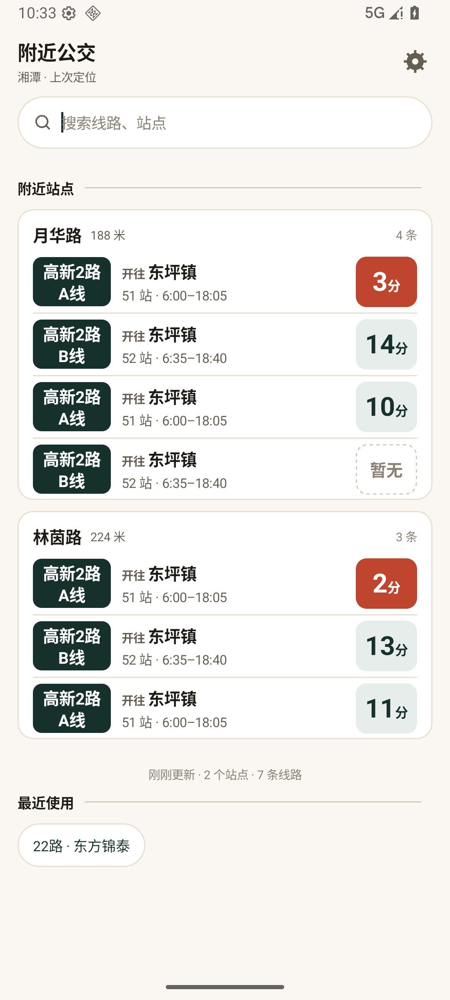
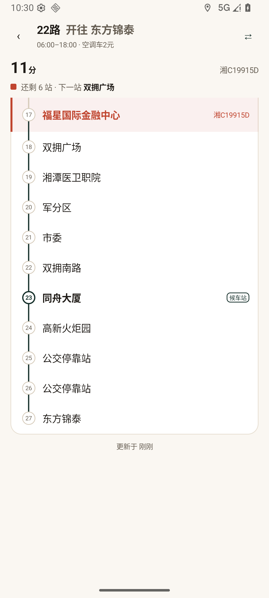

<p align="center">
  <h1 align="center">湘潭BUS</h1>
  <p align="center">面向湘潭的只读公交查询 Android 应用</p>
</p>

<p align="center">
  
  
  
  
  
</p>

<p align="center">
  附近线路 · 实时到站 · 线路搜索 · 线路走向 · 路线规划 · 离线步行导航
</p>

---

## 截图

<p align="center">
  
  &nbsp;&nbsp;
  
  &nbsp;&nbsp;
  
</p>

<p align="center"><sub>附近线路 &nbsp;·&nbsp; 搜索结果 &nbsp;·&nbsp; 线路详情</sub></p>

## 功能

| 功能 | 说明 |
|---|---|
| 附近线路 | 按站点分组，展示到站分钟、距离与最近使用 |
| 搜索 | 线路/站点搜索，local-first（随包种子索引），未命中再联网 |
| 线路详情 | 站序、车辆位置、最多 3 辆车的到站信息、换向、已过站折叠、30 秒刷新 |
| 线路走向 | Canvas 自绘折线，不接地图 SDK |
| 路线规划 | 换乘方案与规划详情，含实时到站与步行分段入口 |
| 离线步行导航 | 端上纯 Java 双向 A*，WGS-84 路由，BD-09/GCJ-02 自动换算 |
| 离线地图 | Mapsforge 渲染湘潭 `.map`，仅用于步行导航页 |
| 字号设置 | 标准/大字两套令牌，同一包内切换 |

## 技术要点

- 包名 `com.xtbus`，原生 Android，无 Gradle，`build.ps1` 手工流水线
- 仅依赖 Android Framework、`org.json`、4 个 androidx AAR 与 Mapsforge
- 城市固定湘潭（车来了 `cityId=173`），不涉及登录、支付、乘车码

## 快速开始

```powershell
cd xtbus-app\app
powershell -ExecutionPolicy Bypass -File .\build.ps1
# 产物：xtbus-app/app/xtbus.apk
```

```powershell
adb install -r xtbus.apk
```

构建环境：

- Android SDK build-tools 36.1.0、platforms/android-34、JDK 21
- 环境变量 `ANDROID_SDK_ROOT`、`XTBUS_LIBS`（jar/AAR 目录，缺省为工程内 `libs/`）
- 签名口令 `XTBUS_STORE_PASS`、`XTBUS_KEY_PASS`，或工程根目录未入库的 `keystore.properties`

中文路径下脚本会自动建立 `D:\xtbus_work` 联接点。仓库不提供 `.jks` 与已签名 APK，请使用自己的证书。

## 目录

```
xtbus-app/
├─ app/
│  ├─ java/com/xtbus/      # 18 个类：Api、Io、Fmt、各 Activity、步行导航
│  ├─ res/                 # 布局、drawable、双套字体/尺寸令牌
│  ├─ assets/              # xiangtan.map、walk_xt.bin、渲染主题、许可文本
│  ├─ libs/ libs025/       # androidx 与 Mapsforge jar
│  ├─ build.ps1  add_dex.py  AndroidManifest.xml
└─ tools/walknav/          # 步行路网数据管线（Python）
```

技术细节见 [湘潭BUS-项目技术文档.md](湘潭BUS-项目技术文档.md)。

## 数据与许可

| 数据/组件 | 来源 | 许可 |
|---|---|---|
| 实时公交、线路、站点 | 车来了 H5 接口 | 第三方服务，仅只读低频调用 |
| 离线底图、步行路网 | OpenStreetMap（Geofabrik 湖南快照，2026-11-14） | ODbL 1.0，需署名并标注数据日期 |
| 地图渲染 | Mapsforge 0.21/0.25 | LGPL-3.0，jar 未修改且可替换 |

代码以 [MIT](LICENSE) 许可发布。

## 免责声明

- 本项目仅供学习与个人使用，与车来了、湘潭公交无隶属关系。
- 源码中的 AES key、签名盐值与 `src` 合作方标识来自公开 H5 前端，用于复刻其请求协议；请勿用于商业分发、批量抓取或绕过风控，由此产生的风险由使用者自行承担。
- 不包含乘车码、支付、账号等任何涉及资金或个人身份的功能。
- 离线地图与路网为 OpenStreetMap 衍生数据，仅供参考，导航结果可能存在偏差。
